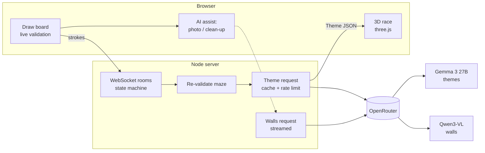

# DoodleMaze Duel: presentation prep

This doc helps the team present DoodleMaze Duel to the judges. It covers the Hacktoberfest Islamabad rubric point by point, a demo script, likely judges' questions with answers, and a technical reference. The user-facing README is [README.md](README.md). Design choices are in [DECISIONS.md](DECISIONS.md).

---

## 1. The 20-second pitch

> "You draw a maze for your friend. Our code turns the doodle into real geometry and proves it can be solved. Then an open-weight vision model, Google **Gemma 3**, looks at the picture, rates its difficulty, roasts it in one line, and designs a 3D world for it. You swap mazes and race through each other's worlds in 3D, and the first to the goal wins. If you don't want to draw, take a photo of any maze and the AI turns it into a playable one."

**One-line description:** a two-player drawing-and-racing game where an open-weight VLM judges, themes and even reads mazes from photos, and deterministic code makes sure every maze is actually playable.

---

## 2. Rubric map

### Eligibility check

| Requirement | Our evidence |
|---|---|
| Open-source / open-weight AI is an important part | **Gemma 3 27B** (Google, open weights) themes and judges every maze. **Qwen3-VL 235B** (Apache-2.0) reads mazes from photos and cleans up doodles, and the two models back each other up. Both run through OpenRouter. Without the AI, a maze is a grey box; with it, every maze gets its own world and verdict. |
| Original, libraries meaningfully extended | All game code was written for this project: the geometry pipeline (simplify, snap, rasterize, Dijkstra), procedural textures, beast AI, sound and netcode. three.js only draws triangles; maze building, collision, cameras, materials and props are ours. No templates and no copied code. |
| Built during the hackathon | The git history starts with "Phase 0: scaffold" on 31 Oct 2026 and shows every phase being added during the day. |
| Public repo with open-source license and clear README | Public on GitHub, with an MIT `LICENSE`. The README has a pitch, screenshots, an architecture diagram, setup and how to play. |
| Submission complete | Repo link, name and description are ready to paste from the submission notes. The game runs on the LAN, so no demo URL is needed. |

### Technology (25%)

**Does the AI meaningfully power a core feature?** Yes, in three places:
1. **AI referee and theme designer.** Gemma sees a clean render of the maze plus stats, then returns structured JSON: whether it is a real maze, whether it is safe to show, difficulty and score, theme name, wall and floor materials, lighting mood, palette, fog, props and a referee comment. That JSON drives the whole 3D world: textures, lights, fog, sky and decorations.
2. **Maze from a photo.** Upload a picture of any maze (printed, whiteboard, hand-drawn) and the VLM returns wall coordinates plus start and goal, which become a playable maze.
3. **AI clean-up.** The VLM redraws a wobbly doodle as clean straight walls.

**Is the implementation effective and demonstrated?**
- A shared TypeScript geometry engine runs in the browser (live feedback in under 50 ms), on the server (re-validates, never trusts the client) and in the race (progress bar).
- Pathfinding runs on walls dilated by the player's radius, so "solvable on the grid" means "your body fits through".
- The multiplayer server is authoritative: a room state machine, a clock-synced countdown, finish-time sanity checks and reconnects.
- AI reliability engineering: model fallback chain, response-format ladder (json_schema, then json_object, then plain text), field-by-field zod validation, a palette contrast fix, streamed wall replies with a time budget, a cache by maze hash and rate limits.
- Proof: `npm test` (25 tests), `npm run sim` (two bots play a full match over WebSockets) and `npm run vlm:test` (one real model call).

### Design (25%)

**Easy to understand and use?**
- One screen per step, each with one clear action: create or join, draw, submit, ready, race, result.
- Live validation while you draw. If the maze can't be solved, the area Start can reach is tinted green, so you can *see* the leak. Corridors that are too narrow are flagged as well.
- Joining by QR code, so the second player doesn't type anything.
- Every wait has a message, a spinner with seconds, and a skip (Skip AI theme). Every AI action can be undone.

**Does the interface support the purpose?**
- The theme card shows exactly what the AI decided (name, palette swatches, difficulty, comment) with an orbiting 3D preview, so the AI's work is visible, not hidden.
- In the race: a beacon on the goal, a bottom-right minimap, three camera views, and an optional beast with a red screen glow and a heartbeat that speeds up as it gets closer.
- The result screen shows both mazes with their shortest paths and the referee's comments.

### Completion (25%)

**Does the main feature work in the demo?** The full loop works: draw, AI theme, swap, race, result. It works with the real model, and it still works when the AI is slow or offline (mock referee, default theme, built-in tracer).

**Clear, usable end-to-end result?** Two laptops on the same Wi-Fi play a complete match. Solo practice works on one laptop. `npm run sim` proves the multiplayer flow headlessly.

Beyond the original plan we shipped: maze from a photo, AI clean-up, the beast, camera views, the minimap and the soundscape.

### Learning (25%)

**New model, tool, framework or approach?**
- First time working with **open-weight VLMs** for structured output (Gemma 3, Qwen3-VL) through **OpenRouter**.
- **three.js** procedural 3D: every texture is drawn in code.
- Computational geometry: Ramer-Douglas-Peucker, endpoint snapping, rasterization, Dijkstra on a dilated grid.
- Real-time networking: WebSockets, a server-authoritative state machine and clock sync.
- **Graphify** to map the codebase as a knowledge graph (see below).

**Can the team explain what it learned?** See section 5, "What we learned (talking points)".

### Tools and models (evidence only)

- **Gemma: Yes.** `google/gemma-3-27b-it` is the primary referee and theme designer, and the fallback for wall tracing. Real run on our laptop: "Ancient Stone Temple", medium 6/10, in 6.4 s, costing about $0.0001. Gemma also traced a spiral maze from a picture (39 walls, start and goal found).
- **Graphify: Yes.** We ran Graphify on the repo to map its structure. It found 376 nodes, 1,065 edges, 9 communities and **no import cycles**. The core abstractions it surfaced were `DrawBoard`, `Pt`, `drawScreen`, `Race`, `MazeScene` and `validateSegments`. Report: [docs/graphify/GRAPH_REPORT.md](docs/graphify/GRAPH_REPORT.md). Interactive graph: [docs/graphify/graph.html](docs/graphify/graph.html) (download and open it in a browser).

---

## 3. Demo script (about 3 minutes)

**Before the judges arrive:** run `npm run vlm:test`, then `npm run build && npm start`, and open the printed LAN URL on laptop B. Keep `MOCK_VLM=1 npm start` ready as plan B.

| Time | Who | What to do and say |
|---|---|---|
| 0:00 | Speaker | The pitch (section 1). |
| 0:20 | A + B | A: **Create room**. B: scan the QR code. "No typing, same Wi-Fi." |
| 0:35 | A | Draw a maze. Draw a wall that seals the goal, then point at the green tint: "it shows you *where* it leaks". Erase it and it turns **Solvable**. |
| 1:00 | B | **Maze from a photo**: upload a photo of a printed maze. "The vision model reads the walls, and our validator still checks them." Undo is available. |
| 1:20 | Both | **Submit**. "The referee is inspecting your maze", with the model name shown. Then the theme card: name, palette, difficulty, the comment and the 3D preview. "Everything you see here came from Gemma's JSON." |
| 1:45 | Both | **Ready**, synced countdown, race. Point out the minimap, the camera switch (V), and the beast if it's on. |
| 2:30 | Both | Result screen: winner, times, both mazes with shortest paths and the referee comments. |
| 2:45 | Speaker | "What we learned" in one sentence, then hand over for questions. |

**If something breaks:** if the AI is slow, press Skip AI theme (default theme). If there's no internet, restart with `MOCK_VLM=1`. If the second laptop can't connect (Wi-Fi client isolation), use a phone hotspot or show Solo practice.

---

## 4. Judges' questions and answers

### About the AI

**Q: What exactly does the AI do?**
Three jobs. (1) Referee and art director: it looks at your maze, checks it really is a maze and is safe to show, rates the difficulty, writes a one-line comment, and designs the theme (materials, palette, light mood, fog, props). (2) Photo to maze: it reads wall lines from a picture. (3) Clean-up: it straightens a messy doodle. The 3D world is built from its JSON answer.

**Q: Which models, and why open-weight?**
Gemma 3 27B (Google) for judging and theming, and Qwen3-VL 235B (Alibaba, Apache-2.0) for reading walls, with each one as the other's fallback. Both are open-weight, which the hackathon requires. Open weights also mean the game could run on our own GPU or a local server later, with no lock-in to one provider. We call them through OpenRouter because it's one API for many open models, with automatic failover.

**Q: Why two models?**
They're good at different things. Theming is a judgement task, and Gemma does it well and fast (about 6 s). Reading walls from a photo needs exact coordinates, and the Qwen-VL family is trained specifically for locating things in images ("grounding"). One setting (`OPENROUTER_WALLS_MODEL`) switches it.

**Q: Is Gemma actually used, or just mentioned?**
It's the default model in the code (`server/vlm/index.ts`). Every submitted maze is themed by it, and it is also the backup for wall tracing. We even adapted the prompts for it: Gemma has no system role, so instructions go in the user message, and it starts in `json_object` mode because strict JSON schema isn't reliably supported for it on OpenRouter.

**Q: What if the model returns garbage?**
We never trust it blindly. The reply is parsed leniently (code fences and chatty text are stripped, and the last JSON object wins), then every field is validated on its own with zod. A bad field gets a default and the rest is kept. Colours are corrected so walls always contrast with the floor. If a call fails completely, the game uses a default theme and the match still goes on.

**Q: What if the AI draws a wall in the wrong place or blocks the maze?**
AI walls are only a *proposal*. They load into the editor as ordinary strokes and go through the same cleaning and pathfinding check as hand-drawn walls. If they block the route, you see the error and can fix it by hand or press Undo. The AI can never make an unwinnable maze reach the race.

**Q: How do you handle slow responses?**
Theme calls have a per-try timeout, one quick retry and a fallback model. Wall replies are **streamed**: we stop after a time budget, at 120 walls, or when the model starts repeating itself, and keep every complete wall received so far. If the AI still fails, a built-in tracer (pure image processing) builds the maze instead.

**Q: How much does it cost?**
About $0.0001 per theme and $0.0003 per photo trace on our runs. Results are cached by maze hash, each player can have only one request in flight, and a room is limited to 6 AI calls per minute. Our $5 budget covers thousands of games.

**Q: Where is the API key? Is it safe?**
It lives only in `.env` on the server, which is gitignored. The browser never sees it: all model calls go through our server.

**Q: Did you fine-tune anything?**
No. We used the models as they are, with careful prompts, structured output and validation. That was a deliberate choice: it keeps the system swappable to any open VLM with one line in `.env`.

### About originality and the build

**Q: What did you build yourselves versus use from libraries?**
Libraries: three.js (WebGL rendering), Express and ws (HTTP and WebSockets), zod (validation), pngjs, qrcode, Vite. Ours: the doodle-to-geometry pipeline, the solver, the collision physics, procedural textures and props, cameras, beast pathfinding, minimap, Web Audio soundscape, the room state machine, clock sync, the AI client with its fallbacks, the photo tracer and all UI.

**Q: Was this built today?**
Yes. The first commit ("Phase 0: scaffold") is from the morning of 31 Oct, and the git history shows each phase after it.

**Q: Did you use AI to write code?**
We used an AI coding assistant (Claude Code) to help build it, and the README says so. The design, product decisions, testing on real hardware and model choices were ours.

### About the tech

**Q: How do you turn a doodle into a maze?**
Five steps. (1) Simplify each stroke with Ramer-Douglas-Peucker. (2) Snap nearby endpoints together, so corners and T-junctions close, and add the outer border. (3) Rasterize the walls into a 200×200 grid, **dilated by the player's radius**. (4) Run Dijkstra from Start to Goal. (5) If there's no path, flood-fill from Start and tint that region, so you see where the leak is.

**Q: Why dilate the walls?**
So the check matches the player's body. A gap thinner than the player looks open on a plain grid, but you can't fit through it. Comparing the raw grid with the dilated one also lets us give a precise "passage too narrow" error.

**Q: How does multiplayer stay fair?**
The server is authoritative. It re-validates both mazes, owns the game phases (lobby, build, swap, countdown, racing, finished), measures each client's clock offset with ping samples so both start at the same instant, and rejects finish times that would be physically impossible.

**Q: How does the beast work?**
It runs on the same dilated grid the player collides with, so it can never cut through walls. It follows the distance field toward you, moves at 72% of your speed (so you can always escape), wakes 4 seconds after GO, and sends you back to the start if it catches you. The closer it gets, the redder the screen edges and the faster the heartbeat.

**Q: How did you test it?**
25 unit tests (geometry, theme parsing, the OpenRouter client with stubbed responses including the Gemma path and streaming), a headless simulation where two WebSocket bots play a whole match, a script that makes one real model call, and manual play on two laptops.

### About limitations

**Q: What doesn't work well yet?**
- Photo tracing is best on clear, high-contrast mazes. Curvy or very dense mazes come back simplified, so the user may need to tidy up.
- Large wall-tracing calls take 10 to 30 s, which is why we stream and have the built-in tracer.
- The game runs on a LAN only: there's no public server or matchmaking.
- The race physics run on the client, and the server only sanity-checks the time, so a determined cheater could fake a plausible time.

**Q: What would you do next?**
Host it online with matchmaking, run Gemma locally for zero cost and offline play, add a shared maze gallery with ratings, and use the referee's difficulty score for ranked play.

---

## 5. What we learned (talking points)

1. **Open-weight VLMs need guard rails for structured output.** Strict JSON schema returned *empty* wall lists from one model, and Gemma doesn't reliably support schema mode. What worked: a format ladder, a compact example in the prompt, lenient parsing and field-level validation.
2. **Pick the model per task.** Gemma is great at judging and theming. Precise coordinates are a different skill (grounding), which led to the separate walls model.
3. **Streaming fixes timeouts.** Instead of waiting for a perfect full answer, we stream and keep the partial result, which turned "timeout, nothing" into "here are the walls received so far".
4. **The AI proposes, code decides.** Letting deterministic code validate everything the AI produces is what makes the game reliable.
5. **Dilate before you pathfind.** "Reachable on the grid" only equals "reachable by the player" after dilating the walls by the player radius.
6. **A float precision bug.** A `Float32Array` for Dijkstra distances, compared against 64-bit numbers, silently skipped nodes and made solvable mazes look unsolvable. The tests caught it.
7. **Clock sync.** Two machines' clocks disagree, so a fair countdown needs a server timestamp plus a measured offset.
8. **Mapping our own codebase with Graphify** confirmed a clean structure (no import cycles), and showed that the drawing board and the shared `Pt` type are the hubs everything depends on.

---

## 6. Technical reference

### Architecture



### Folder map

| Path | What it does |
|---|---|
| `shared/geometry/` | sanitize (RDP, snapping, border), rasterize, Dijkstra, validate (runs in browser and server) |
| `shared/theme.ts` | Theme schema, defaults, contrast fix |
| `shared/protocol.ts` | WebSocket message schemas (zod) |
| `server/rooms.ts` | rooms, game phases, timers, forfeits, AI requests |
| `server/vlm/` | OpenRouter client (themes), walls extraction (streamed), maze PNG renderer, mock referee |
| `client/src/draw.ts` | drawing editor, undo/redo, live validation overlay |
| `client/src/trace.ts` | built-in photo tracer, straightener, auto start/goal |
| `client/src/race.ts` | race loop, HUD, cameras, beast, minimap, sound |
| `client/src/render3d/` | three.js scene, procedural materials, props |
| `scripts/` | `sim` (two-bot match), `vlm:test`, `models:vision` |

### Game flow

Lobby, then Build (3-minute timer with live validation), then Submit (server re-validates, Gemma themes it), then Ready, then Swap, then a synced 3-2-1 countdown, then Race, then Result with paths and comments, then Rematch.

### Key numbers

| | |
|---|---|
| Canvas / grid | 1000×1000 units, 200×200 cells (5 units each) |
| Validation time | under 50 ms (tested) |
| Theme call | about 6 s, about $0.0001 |
| Wall trace call | 10 to 30 s streamed, about $0.0003 |
| Rate limits | 1 in-flight per player, 6 per room per minute, cached by maze hash |
| Beast | 72% of player speed, wakes after 4 s |
| Code | about 4,800 lines of TypeScript, 25 tests |

### Configuration (`.env`)

| Variable | Default | Meaning |
|---|---|---|
| `OPENROUTER_API_KEY` | (empty) | key, server only, gitignored |
| `OPENROUTER_MODEL` | `google/gemma-3-27b-it` | theme / referee model |
| `OPENROUTER_FALLBACK_MODELS` | `qwen/qwen3-vl-235b-a22b-instruct` | fallbacks for themes |
| `OPENROUTER_WALLS_MODEL` | `qwen/qwen3-vl-235b-a22b-instruct` | photo-to-maze and clean-up |
| `MOCK_VLM` | `0` | `1` = offline fake referee |
| `VLM_TIMEOUT_MS` | `15000` | per-try timeout for themes |
| `PORT` | `3000` | server port |

### Commands

```bash
npm install && cp .env.example .env   # add your key to .env
npm run build && npm start            # game on http://localhost:3000 + LAN URL
npm run vlm:test                      # one real theme call
npm run vlm:test -- walls             # one real wall-tracing call
npm test && npm run sim               # unit tests + two-bot match
npm run models:vision                 # list OpenRouter vision models + prices
```
