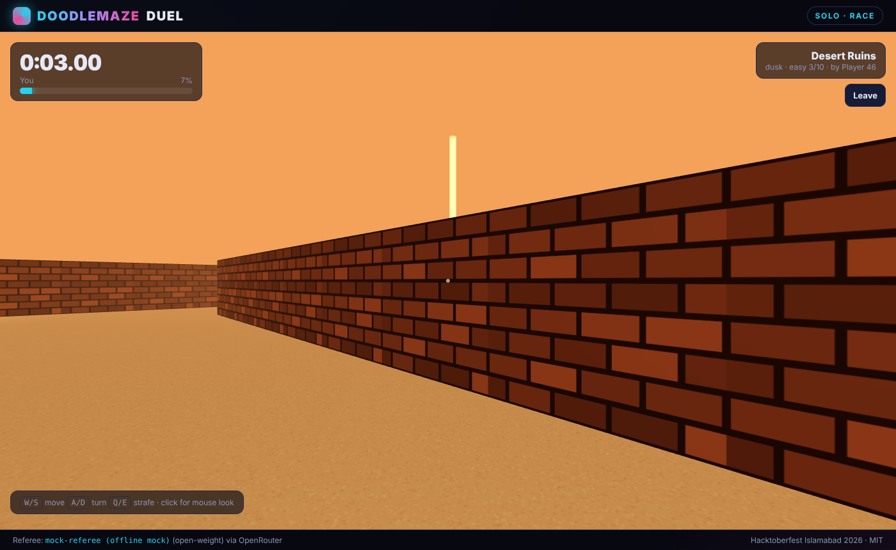
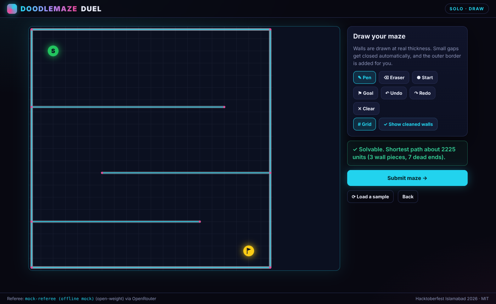
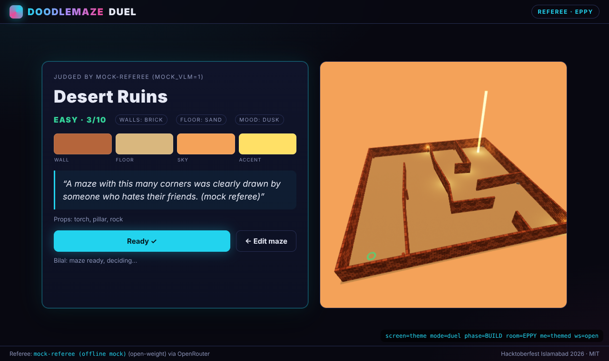
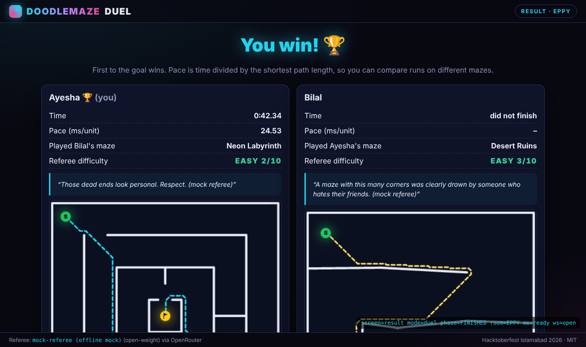
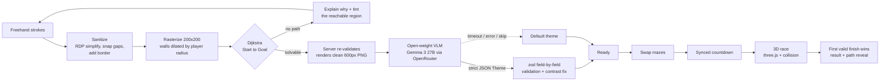

# DoodleMaze Duel

**Draw a maze for your friend, let an open-weight vision model judge it and design its 3D world, then race each other through the mazes. First to the goal wins.**



Two players on the same Wi-Fi each doodle a maze freehand. Our geometry engine cleans the doodle into precise walls and proves it can be solved. An open-weight vision-language model (Google Gemma 3 27B via OpenRouter, with Qwen3-VL as fallback) looks at the maze, rates its difficulty, writes a cheeky referee comment and picks a theme: materials, palette, lighting mood, fog and props. Three.js builds the themed 3D maze, the players swap, a synced 3-2-1 countdown starts, and the first one to find the glowing goal wins.

> **Judges:** a one-page map of this project against the Hacktoberfest Islamabad rubric, the demo script and a Q&A are in **[PRESENTATION.md](PRESENTATION.md)**.

## At a glance (judging rubric)

| Criterion | In one line |
|---|---|
| **Open-weight AI** | **Gemma 3 27B** judges and themes every maze (difficulty, safety check, comment, materials, palette, light, fog, props). **Qwen3-VL** reads mazes from photos and cleans up doodles. Each is the other's fallback. |
| **Technology** | A shared TypeScript geometry engine (simplify, snap, rasterize, Dijkstra on walls dilated by the player radius) runs in the browser and on the server. Authoritative WebSocket rooms with a clock-synced start. AI output is streamed, re-validated field by field and never trusted blindly. |
| **Design** | Live "is it solvable?" feedback that shows *where* a maze leaks, QR join, a visible AI theme card, undo for every AI action, and a skip on every wait. In the race: minimap, camera views, an optional beast with proximity sound. |
| **Completion** | The full loop works on two laptops: draw, AI theme, swap, race, result, rematch. It also works offline (mock referee) and when the AI is slow (built-in tracer, default theme). `npm test` and `npm run sim` pass. |
| **Learning** | First time with open-weight VLMs for structured output, three.js procedural 3D, computational geometry and real-time netcode. See [What we learned](#what-we-learned). |
| **Gemma** | Default model (`google/gemma-3-27b-it`), used for every theme and as the walls fallback. |
| **Graphify** | We mapped the codebase with Graphify: 376 nodes, 1,065 edges, 9 communities, no import cycles. See [docs/graphify/GRAPH_REPORT.md](docs/graphify/GRAPH_REPORT.md) and the interactive [graph.html](docs/graphify/graph.html). |

| Draw (live validation, cleaned walls, debug path) | AI referee theme card + 3D preview | Result with shortest paths |
|---|---|---|
|  |  |  |

## How it works



The same TypeScript geometry module (`shared/geometry`) runs in the browser (instant feedback while drawing), on the server (never trust the client) and in the race (progress bar from the distance field).

## Open-weight AI

- **Primary model:** `google/gemma-3-27b-it` (Google Gemma 3 27B, open weights, multimodal).
- **Fallback:** `qwen/qwen3-vl-235b-a22b-instruct` (Qwen3-VL, open weights, Apache-2.0). OpenRouter's `models` array falls through automatically on rate limits or downtime.
- **Wall tracing model:** `qwen/qwen3-vl-235b-a22b-instruct` (set with `OPENROUTER_WALLS_MODEL`). Photo-to-maze and AI clean-up need exact line coordinates, and Qwen-VL is trained for that kind of grounding, so it does the walls while Gemma does the themes. Gemma is its fallback.
- **Why a VLM:** it sees the maze the way a player would. It judges whether the picture is a real maze, rates difficulty, checks the drawing is safe to show, and designs a theme that fits the shape (a spiral can become "Frozen Catacombs", a garden of short walls an "Overgrown Garden").
- **The AI proposes, code decides:** a model cannot place walls with the 1-unit precision collision needs, and one hallucinated gap would make a maze unwinnable. So walls the AI reads from a photo are only a proposal: they load into the editor as normal strokes, and the same deterministic sanitizer and pathfinder decide whether the maze is playable. The theme is data (a `Theme` JSON) that fixed code consumes.
- **Structured output:** `json_object` mode with the expected shape spelled out in the prompt (Gemma), strict `json_schema` for models that support it, and plain text as a last resort. Every reply is re-validated with zod **field by field**: a bad field gets its default instead of discarding the whole answer. Palettes are corrected for wall/floor contrast so a bad colour choice can never make a maze unplayable.
- **Fallback chain:** model → fallback model → one quick retry → default theme. The game always completes, even offline (`MOCK_VLM=1`) or when the player presses **Skip AI theme**.
- **Cost control:** results cached by maze hash, one in-flight call per player, max 6 calls per room per minute, `max_tokens: 600`. A call costs well under a cent.

- **AI assist while drawing:** *Maze from a photo* sends a picture of any maze (printed, hand-drawn, whiteboard) to the VLM, which returns wall segments plus Start/Goal as strict JSON. *AI clean-up* turns a wobbly doodle into clean straight walls. Both are only proposals: they load into the editor as ordinary strokes and go through the same sanitizer and pathfinding check, and Undo restores the old drawing. Without the AI, a built-in tracer (threshold + line runs) and straightener do the same job more roughly.

Where the AI shows in the UI: the "referee is inspecting your maze" screen (with the model name), the theme card (name, palette, difficulty, comment), the race intro before the countdown, the result screen, and the footer.

## Setup

Requires **Node 20+**.

```bash
npm install
cp .env.example .env        # then put your key in .env: OPENROUTER_API_KEY=sk-or-...
npm run build
npm start                   # serves the game + WebSocket on port 3000
```

The server prints its LAN address on boot, e.g. `http://192.168.1.23:3000`. Open it on both devices (same Wi-Fi). The lobby also shows a QR code and a copyable link.

- **Check the AI referee:** `npm run vlm:test` sends one bundled maze to the model and prints the theme it returns. `npm run vlm:test -- walls` tests wall tracing.
- **Offline mode:** `MOCK_VLM=1` (or no key at all) uses a deterministic fake referee after 800 ms.
- **Solo practice:** from the home screen, race a bundled maze or draw your own and have it themed.
- **Development:** `npm run dev` (server on 3000 + Vite on 5173 with hot reload). Add `?debug=1` for FPS, the shortest-path overlay and the state machine.
- **Checks:** `npm test` (geometry, theme parsing, PNG) and `npm run sim` (two headless WebSocket clients play a full match and the winner is asserted).
- **Other models:** `npm run models:vision` lists OpenRouter vision models with prices and flags open-weight families. Switch with `OPENROUTER_MODEL` / `OPENROUTER_FALLBACK_MODELS` (themes) and `OPENROUTER_WALLS_MODEL` (photo and clean-up) in `.env`.

## How to play

1. One player presses **Create room**, the other joins with the 4-letter code, the link, or the QR code.
2. Draw walls with the pen (mouse, touch or stylus), or use **AI assist**: upload a photo of a maze, or let the AI clean up your doodle. Place **Start ●** and **Goal ⚑**. The panel tells you live whether the maze is solvable; if not, the area Start can reach is tinted green so you can see the leak. Passages narrower than the player are rejected too.
3. **Submit**. The AI referee judges it and shows its theme card. Press **Ready**.
4. When both are ready, mazes are swapped and a synced countdown starts.
5. Race: **W/S** forward/back, **A/D** turn (arrow keys work), **Q/E** strafe, **V** switch camera (first-person / third-person; overhead in solo), **M** show/hide the minimap, click for mouse look. Follow the glowing beacon; the minimap in the bottom-right corner shows you, the goal and the beast.
6. **Beast mode (optional):** tick "Add a beast" while drawing and a shadow beast lives in your maze. It wakes 4 s after GO, hunts the racer through the corridors (pathfinding on the same grid as collision), and sends them back to the start if it catches them. The screen edges glow red, and a low drone and heartbeat get louder and faster the closer it is.
7. **First to the goal wins.** Pace (ms per unit of shortest path) lets you compare runs on different mazes but does not decide the winner.

The build timer (default 3 min) auto-submits a valid maze when it runs out; an invalid one gets 30 s of overtime and is then replaced with a bundled maze.

## What we learned

- **Getting reliable structured output from an open-weight VLM.** JSON-schema mode where supported, `json_object` fallback, fence stripping, "last JSON object wins" extraction, and per-field zod defaults so one bad value never sinks a response.
- **Turning doodles into geometry.** Ramer-Douglas-Peucker simplification, endpoint snapping to close small gaps (T-junctions and corners), and the insight that pathfinding must run on walls **dilated by the player radius**, so "reachable on the grid" equals "reachable by the player's body". The same idea gives a clear "too narrow" error: solvable on the raw grid but not the dilated one.
- **A float precision bug in Dijkstra:** storing distances in a `Float32Array` while comparing against float64 values silently skipped nodes and made solvable mazes look unsolvable. Caught by tests on hand-made fixtures.
- **Pick the model per task.** Gemma 3 is fast and good at judging and theming. Precise wall coordinates are a different skill (visual grounding), so photo tracing uses Qwen3-VL, with Gemma as the fallback.
- **Streaming beats timeouts.** Wall replies are streamed with a time budget, and we keep every complete wall received so far, so a slow model still gives a usable answer.
- **Mapping our own code with Graphify** confirmed a clean structure (no import cycles), with the drawing board and the shared point type as the hubs.
- **Procedural 3D.** Every texture (brick, hedge, ice cracks, neon edges, wood grain) is drawn on a canvas in code, walls are merged into a single draw call with UVs in metres, and lighting changes with the AI-chosen mood.
- **Authoritative multiplayer.** The server re-validates every maze, owns the room state machine, computes a clock offset from ping samples so both players start on the same absolute timestamp, and rejects physically impossible finishes.

## Project structure

```
client/          Vite + vanilla TypeScript
  src/draw.ts        freehand editor + live validation
  src/race.ts        first-person race controller + HUD
  src/game/physics.ts circle-vs-segment collision, controls
  src/render3d/      three.js scene, procedural materials, props
  src/main.ts        screens and flow
server/          Express + ws, in-memory rooms
  rooms.ts           room/player state machines, protocol handling
  vlm/               OpenRouter client, PNG renderer, mock referee, model checks
shared/          used by both sides
  geometry/          sanitize, rasterize, solve (Dijkstra), validate
  theme.ts           Theme schema (zod), defaults, contrast helpers
  protocol.ts        WebSocket message schemas
  samples/           3 hand-designed mazes (also test fixtures)
scripts/         sim (headless match), models:vision, vlm:test
tests/           vitest
docs/            screenshots, graphify/ (codebase knowledge graph)
```

**Tech:** TypeScript, Node, Express, ws, three.js, Canvas 2D, zod, pngjs, Vite, Vitest, OpenRouter.

## License and credits

MIT, see [LICENSE](LICENSE). All code, textures and sounds are generated for this project (procedural canvas textures, Web Audio tones, system fonts). Built at **Hacktoberfest Islamabad 2026** with the help of an AI coding assistant (Claude Code). Design notes are in [DECISIONS.md](DECISIONS.md), and presentation prep is in [PRESENTATION.md](PRESENTATION.md).
